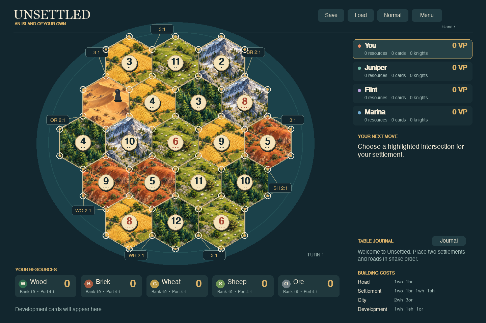
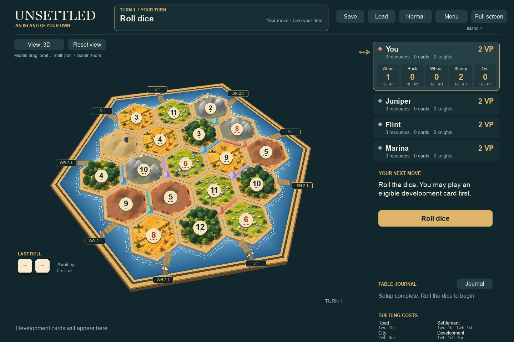

# Unsettled

A single-player, offline implementation of the classic Catan base game in Python
and Pygame. Play against two or three simulated opponents, with original
illustrated terrain, player trading, ports, development cards, and save/resume.
No accounts, internet connection, turn timers, or external AI service are needed
while playing.



The dark tabletop uses illustrated woodland, terracotta quarries, golden fields,
green pastures, lavender mountains, and sandy tile borders, surrounded by a
light-blue hexagonal sea with an engraved golden frame. Wooden piers and
moored sailboats mark the nine ports. Beveled roads and faceted settlements and cities give
the board a painted wooden-piece feel. Text renders at the window's native
resolution.

## Set up on macOS

Install [pyenv](https://github.com/pyenv/pyenv#installation) if it is not already
available, and enable its shell integration as described in its documentation.
Then, in this project directory:

```sh
pyenv install -s 3.13.15
pyenv local 3.13.15
python -m venv .venv
source .venv/bin/activate
python -m pip install -r requirements.txt
python -m unsettled
```

The repository's `.python-version` selects Python 3.13.15. The `.venv` isolates
all project packages from your other Python projects. On the machine where this
project was built, Python and the virtual environment are already installed.

For later sessions, run:

```sh
cd /Users/hjlarrea/git/unsettled
source .venv/bin/activate
python -m unsettled
```

You can also launch without activating the environment:

```sh
.venv/bin/python -m unsettled
```

If `python` is not the pyenv-selected interpreter, run `pyenv which python` and
check your shell initialization before creating the virtual environment. The
pinned Pygame dependency has a native macOS Apple Silicon wheel for Python 3.13;
no separate SDL installation is needed on the tested machine.

## Play

Choose **You + 2 bots** or **You + 3 bots**. Click an opponent's difficulty to
switch between Easy and Standard. Choose the recommended board or a random
island; clear the seed field to generate a new seed, or enter a number to repeat
a board. The seed repeats the island layout; each new interactive game uses
fresh randomness for dice, the starting player, thefts, and the shuffled deck.
Saved games preserve their random state for exact continuation.
Click **Set sail** to start.

- During setup, click a highlighted intersection, then a highlighted edge.
  Placement follows snake order. Your second settlement supplies your starting
  resources. The starting player is chosen randomly.
- On your turn, **Roll dice**, then build, trade, play a development card, or
  **End turn**. An eligible development card can also be played before rolling.
- The last roll appears as two graphical dice with pips and their total,
  for both your rolls and opponents’ rolls.
- Click **Road**, **Settlement**, or **City**, then click a highlighted location.
  Disabled buttons indicate insufficient resources or no legal placement.
- **Bank / ports** automatically uses your best available exchange rate.
  Port labels use WO (wood), BR (brick), WH (wheat), SH (sheep), and OR (ore).
- **Player trade** lets you choose an opponent and the quantities on each side.
  Bots can accept, decline, or counter. Every bot offer addressed to you pauses
  the game until you respond. There is one counteroffer per negotiation.
- When a seven is rolled, select discards if needed. The rolling player then
  clicks a different hex for the robber and chooses an eligible theft victim.
- Development cards appear along the bottom. Playable cards become buttons;
  new purchases must wait until a later turn. Victory Point cards count
  automatically. Only one action development card may be played per turn.
- The header highlights the current turn and phase, including trade responses
  and robber decisions. During computer turns, its bar fills until the next
  action; each action starts a fresh bar. Dialogs pause computer play.
- Turns have a short announcement, a central dice reveal, producing-tile
  highlights, and resource transfers into the appropriate player panel or your
  resource strip. Counts increase as resources arrive. Sevens lead into discard
  or robber instructions; bank shortages show only resources actually paid.
- **Space** skips the current presentation. **Motion: Full / Reduced** in the
  menu switches to short, static cues. Effects pause while a menu or dialog is open.
- **Slow / Normal / Fast** pauses 4.0 / 2.5 / 1.2 seconds between bot actions,
  after any presentation finishes; it also adjusts new effects. Normal is the default. No human decision has a time limit. Open **Menu** to pause and configure a new game.
- **Journal** or **L** opens the public event history. **Escape** closes a dialog,
  cancels a selected build tool, or opens/closes the menu. **Cmd+S** / **Ctrl+S**
  saves manually.
- **Full screen**, **F11**, or **Cmd+F** / **Ctrl+F** toggles full-screen mode.
  **Escape** returns to the window after closing any dialog or build tool.
  Resizing and full-screen mode use the entire window: controls anchor to the
  right, resource counters stay in a strip below the board, and the board
  centers below the title bar.
  Tiles keep their proportions and text stays sharp.

Your resources appear in a fixed strip below the board, with an icon and your
count for each resource. Hover to see its name, bank supply, and your port rate. Your resource cards
and development-card identities remain private. Opponent
hand sizes, development-card counts, played knights, and public victory points
are visible. **R** and **A** mark Longest Road and Largest Army. Opponents' hidden
Victory Point cards are revealed in their scores at game end. First to at least
10 points **on their own turn** wins.

## Experimental 3D board

The board includes a switchable perspective view.
Choose **2D board** or **3D board** under **Board** in the menu. You can also
click **View: Classic** above the board, or press **P**, to switch at any point
in a game. The same game and legal placement rules apply in both views.
- **Middle-button drag** orbits the board and changes its tilt.
- **Shift + middle-button drag** pans the camera.
- **Scroll wheel** zooms in and out over the board.
- **Reset view** or **Home** restores the starting camera.
- **Left click** still places pieces and selects the robber's destination.



This prototype uses software-rendered terrain in Pygame, combining illustrated
ground with rounded, softly shaded forest canopies and sheep, continuous mountain
ridges with snow and rock shading, layered clay hills, and rolling dunes.
Buildings, crops, ports, and the thick board frame retain their 3D geometry.
Number tokens and port labels face the screen for readability. The interface
stays fixed while the board moves, and dialogs pause camera controls. Camera
settings are temporary and do not affect saves. The classic view retains its
illustrated terrain, which is also projected onto the 3D board. Static scenery
and projected ground textures are cached to keep normal play responsive.
Complex overlapping geometry uses depth sorting rather than a GPU depth buffer,
so this is a visual and interaction prototype rather than a finished 3D renderer.

## Saves

The game autosaves after every completed action and when you close an active
game. **Resume autosave** continues exactly where you stopped, including pending
trades, discards, card choices, the random-generator state, and bot planning.
**Save** writes a separate manual slot; **Load** opens that slot.

On macOS saves are stored in:

```text
~/Library/Application Support/Unsettled/autosave.json
~/Library/Application Support/Unsettled/manual.json
```

Starting a new game replaces the autosave. Use **Save** first if you want to keep
the old game in the manual slot. Writes are atomic. An unreadable or unsupported
save displays an error and leaves the current game intact. If autosave fails,
bots pause; **Save** retries it. Bot animation speed is a session preference.

## Opponents and rules

Easy and Standard bots use bounded local heuristics. Standard considers dice
probabilities, resource balance, expansion routes, ports, trades, robber targets,
and opponent scores. Easy uses noisier placement and simpler trade valuation.
Juniper favors cities and development, Flint favors expansion, and Marina favors
roads. They receive their own hand plus public board information; they cannot
inspect other hands, the deck order, or future rolls. These are casual heuristic
opponents, not tournament-strength search agents.

Rules references: [official base-game rulebooks](https://www.catan.com/understand-catan/game-rules)
and [base-game FAQ](https://www.catan.com/faq/basegame). Included rules cover finite
bank and piece supplies, snake setup, domestic and maritime trading, all five
development-card types, robber/discards/theft, Longest Road including branches
and blocked routes, Largest Army, award ties, and hidden victory points.
Random islands shuffle terrain and number tokens with no adjacent 6/8 hexes.
There are no expansions, house-rule toggles, multiplayer, undo, or move hints.

This is an independent personal implementation. Original terrain art was
created for this project; official artwork, logos, and rulebook text are not
bundled. See [asset provenance](unsettled/assets/README.md).

## Development and verification

```sh
source .venv/bin/activate
python -m pip install -r requirements-dev.txt
python -m pytest -q
python -m unsettled --simulate 10 --bots 2 --seed 1
python -m unsettled --simulate 10 --bots 3 --seed 1
```

The simulation command runs all seats as bots without importing Pygame. Every
action checks state invariants; illegal moves or games that exceed the command
limit report the seed, turn, and phase. Both difficulties are exercised.

For an offscreen render:

```sh
SDL_VIDEODRIVER=dummy SDL_AUDIODRIVER=dummy \
  python -m unsettled --screenshot /tmp/unsettled.png
```

The engine is independent of Pygame. `engine.py` owns legal commands, phases,
scoring, and observations; `bots.py` chooses one action from an observation;
`persistence.py` handles versioned JSON; `ui.py` renders and translates input.
Both humans and bots use `Game.command(player, action, **arguments)`. Invalid
gameplay commands raise `RuleError`. Future expansions can extend the engine
without embedding game rules in rendering code.

Automated UI checks use SDL's dummy video driver. These verify dialog flows and
full human-seat command sequences, but do not replace hands-on usability testing
of a real macOS window.
